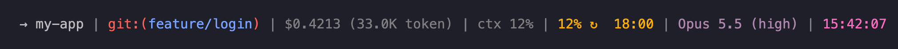
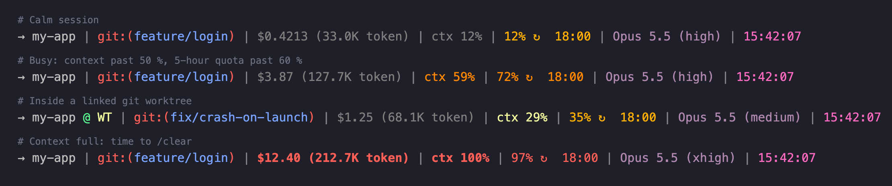
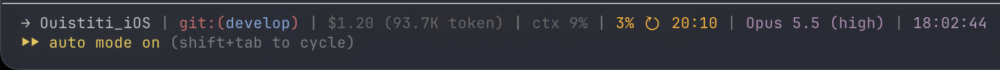
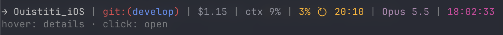
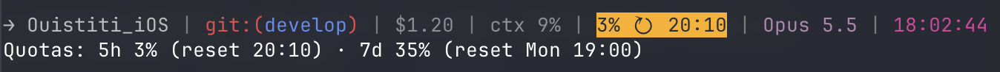
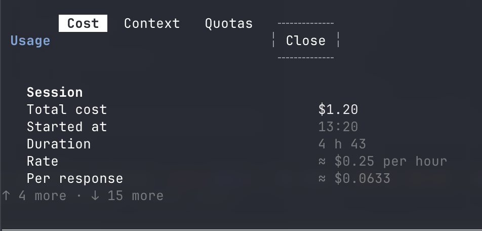
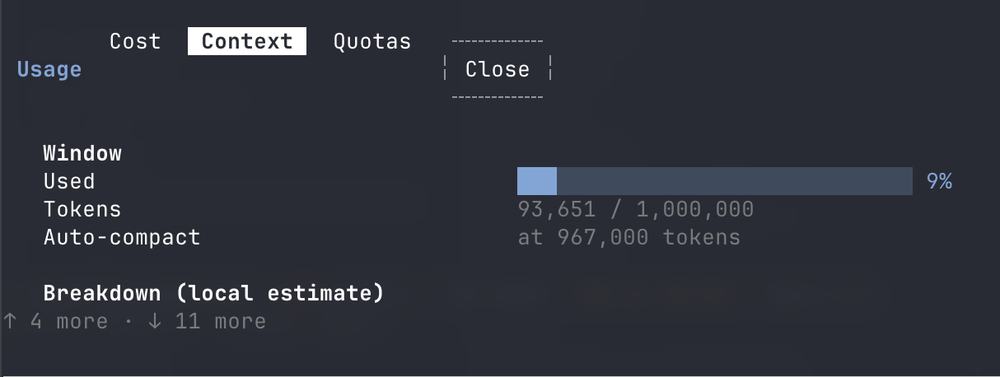
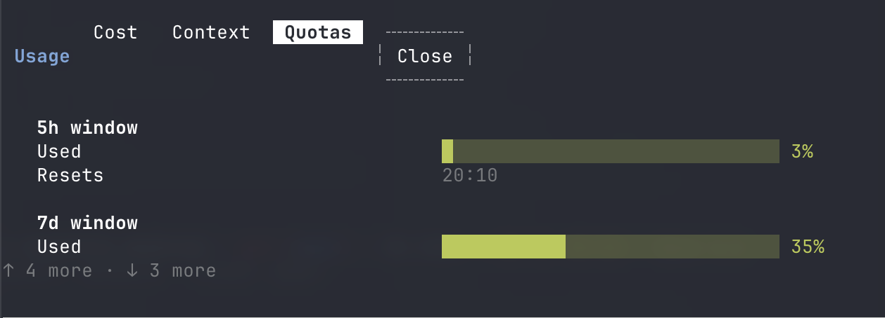

# claude-usage-statusline

A compact, color-coded status line for [Claude Code](https://code.claude.com), plus **usage-band**, a Claude Code mod that turns that line into an interactive band above the prompt: hover a segment for details, click it to open a cost / context / quota panel.



Two independent pieces, use one or both:

| | What it is | Install |
| --- | --- | --- |
| `statusline-command.sh` | A classic Claude Code status line script (`statusLine` setting) | Copy the script, add one setting |
| `usage-band` | A Claude Code mod (hooks-module plugin) drawing the same line as a clickable band | One `/plugin install` line |

## What the line shows



| Segment | Example | Color |
| --- | --- | --- |
| Folder | `→ my-app` | light grey; `@ WT` is added inside a linked git worktree (the folder stays the main repository's) |
| Git branch | `git:(feature/login)` | red frame, blue branch name; short commit hash when detached |
| Session cost | `$0.4213 (33.0K token)` | grey; 4 decimals under $1, 2 from $1 up; bold red once the context is full |
| Context used | `ctx 12%` | grey under 20 %, yellow from 20 %, orange past 50 %, bold red past 75 % |
| 5-hour quota | `12% ↻  18:00` | used share and reset time; amber, orange past 60 %, red from 95 % |
| Model | `Opus 5.5 (high)` | greyed plum, with the reasoning effort when set |
| Last response | `15:42:07` | magenta, local time of the last assistant message |

When less than 1 % of the context is left, the line shows `ctx 100%` in bold red and turns the cost red too: that is the cue to `/clear` or `/compact`.

In a real terminal, as Claude Code draws it under the prompt:



## The usage-band mod

The mod runs the same script and draws its output as a band above the prompt, each segment a button. The band keeps each segment short: the token count and the effort move to the hover cards.



Hovering the quota segment highlights it and shows every rate-limit window, with its reset, in place of the hint:



Clicking cost, context or quota unfolds the details panel on that tab:

| Cost | Context | Quotas |
| --- | --- | --- |
|  |  |  |

In detail:

- **Hover** a segment: a one-line card replaces the hint under the band (folder path, repository URL, cost per hour and token count, context tokens left, every quota window with its reset).
- **Click** cost, context or quota: a details panel unfolds under the band, with three tabs:
  - **Cost**: total, start time, duration, cost per hour and per response, input / output / cache tokens, cache hit rate, breakdown by model (subagents included).
  - **Context**: a usage bar, tokens used out of the window, the auto-compact threshold, and a breakdown by category.
  - **Quotas**: a bar and a reset time for each rate-limit window (5 h, 7 d, …).
- **Click** the folder: opens it (its Xcode workspace, project or Swift package when there is one).
- **Click** the branch: opens the repository on GitHub / GitLab (the branch page once it is pushed).
- **Click** the model: a toast with the full model id and the effort level.
- `/usage-details` shows or hides the panel from the keyboard.

The band runs, in this order: the `statusLine` command from your settings if you have one, else `~/.claude/statusline-command.sh` if it exists, else the copy of the script shipped inside the mod. So the mod works on its own, and if you keep your own status line script, the band draws yours. Once the band is installed you can remove the classic `statusLine` setting so the line is not shown twice.

## Requirements

- Claude Code. The mod needs a version that supports mods (plugins with a `hooks/hooks.json` hooks module); it was built and tested on Claude Code 2.1.314.
- `bash`, [`jq`](https://jqlang.org), `git`, `python3` (used for the reset time and the last response time; without it those two segments are left out).
- macOS for the band's folder and branch clicks (they use `open`). The script itself also runs on Linux.

On macOS: `brew install jq` (git and python3 come with the Xcode Command Line Tools).

## Install with Claude Code

Paste this prompt into a Claude Code session and let it do the work:

```text
Install the status line and the usage-band mod from https://github.com/Quimoune/claude-usage-statusline:
1. Download https://raw.githubusercontent.com/Quimoune/claude-usage-statusline/main/statusline-command.sh
   to ~/.claude/statusline-command.sh and make it executable.
2. In ~/.claude/settings.json, set "statusLine" to
   {"type": "command", "command": "bash ~/.claude/statusline-command.sh"}
   and keep every other setting as it is.
3. Check that jq, git and python3 are installed, and tell me how to install any that is missing.
4. Run: claude plugin install usage-band --marketplace Quimoune/claude-usage-statusline
```

Skip steps 1–2 if you only want the band, or step 4 if you only want the status line. The status line shows up on the next message; the band in the next session.

## Install by hand

### The status line

```bash
curl -fsSL https://raw.githubusercontent.com/Quimoune/claude-usage-statusline/main/statusline-command.sh \
  -o ~/.claude/statusline-command.sh
chmod +x ~/.claude/statusline-command.sh
```

Then add this to `~/.claude/settings.json`:

```json
{
  "statusLine": {
    "type": "command",
    "command": "bash ~/.claude/statusline-command.sh"
  }
}
```

### The usage-band mod

At the prompt of a terminal session:

```text
/plugin install usage-band --marketplace Quimoune/claude-usage-statusline
```

Answer `y` to add the marketplace, then pick a scope (user scope, the first one, makes it active in every session).

From a shell:

```bash
claude plugin install usage-band --marketplace Quimoune/claude-usage-statusline
```

In the Claude desktop app, where `/plugin` does not run: click **+** next to the prompt box, then **Plugins**, **Add marketplace** with `Quimoune/claude-usage-statusline`, then **Add plugin**.

To update later: `claude plugin update usage-band`, then `/reload-plugins` in a running session.

## Customize

Colors are ANSI codes at the top of `statusline-command.sh` (`GRAY`, `AMBER`, `MODEL_GREY`, …), and the thresholds sit next to each segment. To test a change without Claude Code, pipe a sample of the JSON Claude Code sends on stdin:

```bash
echo '{"workspace":{"current_dir":"'"$PWD"'"},"model":{"display_name":"Opus 5.5"},
  "cost":{"total_cost_usd":0.42},"context_window":{"remaining_percentage":80}}' \
  | bash statusline-command.sh
```

The band picks segments by their text (`→`, `git:(`, `$`, `ctx`, `↻`) and splits them on the dim ` | ` separator, so keep those if you edit the script and use the band.

## Develop the mod

```bash
claude plugin validate .   # manifest, marketplace and hooks module
claude plugin test .       # tests/band.test.tsx
claude --plugin-dir .      # a session with this checkout loaded
```

## License

[MIT](LICENSE)
